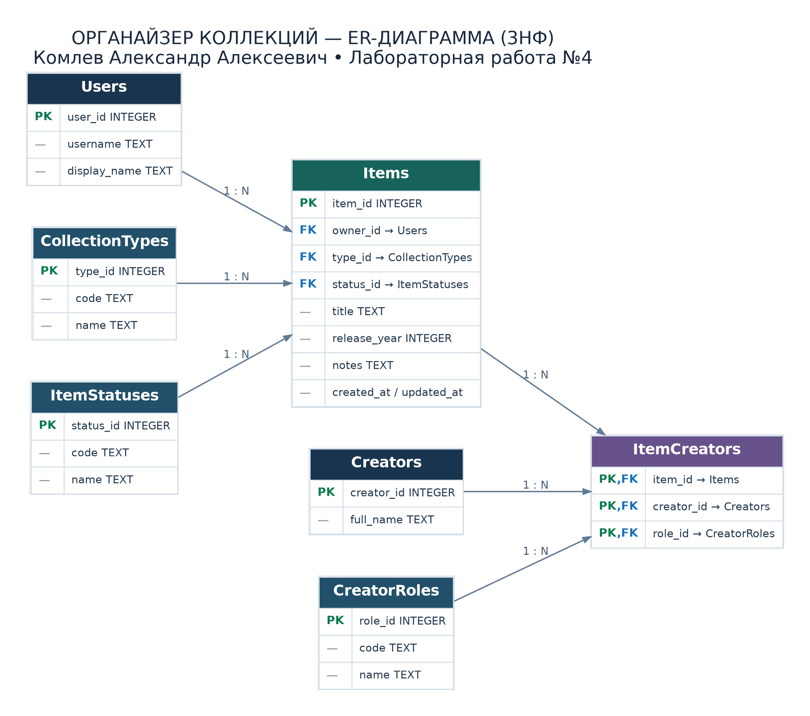

# Проектирование и нормализация базы данных «Органайзер коллекций»

**Лабораторная работа №4**  
**Студент:** Комлев Александр Алексеевич  
**Репозиторий:** [Moonakan/smart-todo-srs](https://github.com/Moonakan/smart-todo-srs)  
**СУБД:** SQLite  
**Цель:** спроектировать нормализованную до 3НФ реляционную схему для учёта книг, винила, фильмов и игр.

> **Граница работы.** Веб-прототип из лабораторной №3 пока использует `localStorage`. В этой лабораторной проектируется и проверяется отдельная схема SQLite. Подключение веб-интерфейса к SQLite не реализуется.

## 1. Анализ предметной области

Пользователь ведёт личную коллекцию книг, виниловых пластинок, фильмов и игр. Для каждого предмета нужны название, тип, статус («В коллекции»/«Хочу приобрести»), необязательный год выпуска, описание и сведения о создателях. У предмета может быть несколько создателей, и один создатель может участвовать в нескольких предметах. Один пользователь может иметь много предметов.

**Сущности:**

1. `Users` — владельцы коллекций.
2. `CollectionTypes` — справочник видов предметов (`book`, `vinyl`, `movie`, `game`).
3. `ItemStatuses` — справочник статусов (`owned`, `wishlist`).
4. `Items` — предметы коллекций.
5. `Creators` — создатели произведений (автор, исполнитель, режиссёр, разработчик).
6. `CreatorRoles` — справочник ролей создателей.
7. `ItemCreators` — связь между предметами, создателями и ролями.

## 2. Исходная денормализованная структура

Возможна одна широкая таблица:

```text
Items_Flat (
  item_id, title, release_year, notes,
  owner_id, username, display_name,
  type_code, type_name,
  status_code, status_name,
  creator_names, creator_roles
)
```

Например, в одной ячейке `creator_names` могла бы храниться строка `Алексей Орлов, Мария Лебедева`, а в `creator_roles` — `Автор, Автор`.

**Проблемы:**

- **Избыточность:** название категории «Книга» и имя владельца многократно повторяются в карточках.
- **Аномалия обновления:** смена названия типа потребовала бы изменения множества предметов.
- **Аномалия добавления:** нельзя создать новую категорию, пока не добавлен хотя бы один предмет.
- **Аномалия удаления:** удаление последнего предмета некоторого вида способно удалить единственное упоминание этой категории.
- **Неатомарность:** перечень создателей и ролей в одном поле затрудняет поиск, обновление и целостность.

## 3. Приведение к 1НФ (первой нормальной форме)

**Требование 1НФ:** каждая ячейка содержит одно значение, нет повторяющихся групп.

**Изменение:** вместо списка авторов в `creator_names` используются отдельные строки для каждого создателя в связующей таблице `ItemCreators`. Название, тип, статус, год и примечание предмета хранятся отдельными полями.

**Результат:** атомарные значения и однозначно идентифицируемые строки.

## 4. Приведение к 2НФ (второй нормальной форме)

**Требование 2НФ:** выполнена 1НФ; каждый неключевой атрибут полностью функционально зависит от всего первичного ключа, а не от его части.

**Изменение:** таблицы `Items`, `Users`, `Creators`, `CollectionTypes`, `ItemStatuses` и `CreatorRoles` имеют простые первичные ключи; их атрибуты относятся к соответствующей записи. В `ItemCreators` составной первичный ключ `(item_id, creator_id, role_id)`, и эта таблица не содержит неключевых описательных полей, которые могли бы зависеть только от одной части ключа.

**Результат:** частичных зависимостей не остаётся. Важно: для таблицы с одиночным PK требование 2НФ выполняется автоматически после 1НФ; вынос справочников сам по себе в первую очередь нужен для устранения транзитивных зависимостей и повторов.

## 5. Приведение к 3НФ (третьей нормальной форме)

**Требование 3НФ:** выполнена 2НФ; неключевые атрибуты не должны транзитивно зависеть от первичного ключа через другие неключевые атрибуты.

В плоской карточке зависимости были бы, например:

- `item_id → type_code → type_name`;
- `item_id → status_code → status_name`;
- `item_id → owner_id → username`.

Чтобы не хранить чужие названия в `Items`, мы оставляем там только внешние ключи `type_id`, `status_id`, `owner_id`. Их описания вынесены в соответствующие таблицы. Имя создателя хранится только в `Creators`, название роли — только в `CreatorRoles`.

**Результат:** данные категорий, статусов, владельцев и создателей хранятся в одном месте; повторение справочной информации исключено.

## 6. ER-диаграмма и связи



- `Users (1) → (N) Items`: один владелец может хранить несколько предметов.
- `CollectionTypes (1) → (N) Items`: каждый предмет имеет один тип, у типа много предметов.
- `ItemStatuses (1) → (N) Items`: каждый предмет имеет один статус.
- `Items (1) → (N) ItemCreators` и `Creators (1) → (N) ItemCreators`: вместе реализуют связь `Items ↔ Creators` типа **M:N**.
- `CreatorRoles (1) → (N) ItemCreators`: у каждой связи указан характер участия (автор, исполнитель и т. д.).

**PK** — первичный ключ; **FK** — внешний ключ. Для `ItemCreators` применяется составной PK `(item_id, creator_id, role_id)`, предотвращающий повтор одинаковой тройки.

## 7. Логическая схема (основные атрибуты)

| Таблица | Первичный ключ | Внешние ключи | Назначение |
| --- | --- | --- | --- |
| `Users` | `user_id` | — | Владелец коллекции |
| `CollectionTypes` | `type_id` | — | Тип: книга, винил, фильм, игра |
| `ItemStatuses` | `status_id` | — | Статус: в коллекции, хочу приобрести |
| `Creators` | `creator_id` | — | Создатели произведений |
| `CreatorRoles` | `role_id` | — | Роли создателей |
| `Items` | `item_id` | `owner_id`, `type_id`, `status_id` | Название, год, описание, даты |
| `ItemCreators` | `(item_id, creator_id, role_id)` | Все три столбца | Связь многие-ко-многим |

## 8. Реализация в SQLite

- Скрипт создания: [`database/schema.sql`](https://github.com/Moonakan/smart-todo-srs/blob/main/database/schema.sql).
- Тестовые данные: [`database/seed_data.sql`](https://github.com/Moonakan/smart-todo-srs/blob/main/database/seed_data.sql).
- Дополнительные запросы: [`database/check_queries.sql`](https://github.com/Moonakan/smart-todo-srs/blob/main/database/check_queries.sql).
- ER-диаграмма: [`docs/database/er_diagram.png`](https://github.com/Moonakan/smart-todo-srs/blob/main/docs/database/er_diagram.png) и [`SVG`](https://github.com/Moonakan/smart-todo-srs/blob/main/docs/database/er_diagram.svg).

Схема включает `NOT NULL`, `UNIQUE`, `CHECK`, внешние ключи с действиями `ON DELETE`, а также индексы `idx_items_owner_type_status`, `idx_items_type_id`, `idx_items_status_id`, `idx_items_title`, `idx_item_creators_creator_id`, `idx_item_creators_role_id`.

**Примечание об индексах:** B-tree индекс `idx_items_title` полезен для сортировки и некоторых видов поиска по префиксу, но не гарантирует ускорения поиска с шаблоном `LIKE '%фрагмент%'`. Для полнотекстового поиска в будущем можно использовать FTS5.

## 9. Проверка тестовыми данными

1. Создать пустую базу SQLite.
2. Выполнить `schema.sql`.
3. Выполнить `seed_data.sql` **один раз** для новой базы.
4. Выполнить `check_queries.sql` либо отдельные `SELECT`-запросы.
5. Проверить `PRAGMA foreign_key_check;` — ошибок быть не должно.

Тестовые данные **вымышленные**; на новой базе должно появиться **7 таблиц, 8 предметов, 4 типа, 2 статуса, 9 связей предмет–создатель**. У владельца `Moonakan` — **2 книги** и **3 предмета в списке желаний**.

## 10. Вывод

Спроектирована схема SQLite из семи таблиц, нормализованная до 3НФ. Вынесены повторяющиеся справочники, показаны PK/FK и связь M:N, добавлены ограничения и индексы. Схема предназначена для дальнейшей интеграции; существующий прототип лабораторной №3 пока продолжает хранить данные в `localStorage`.
