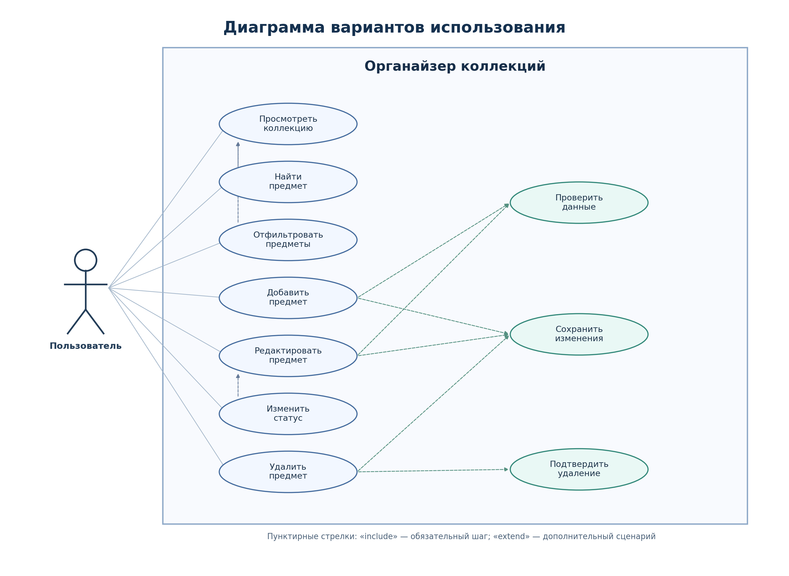
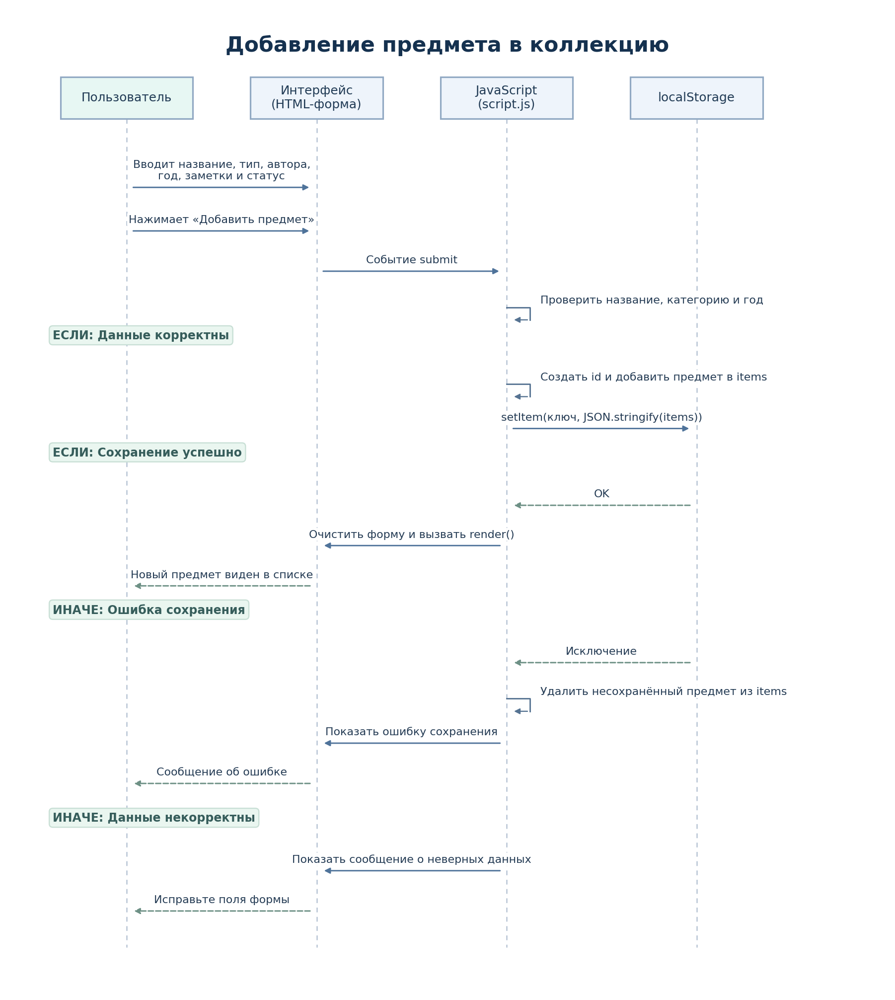
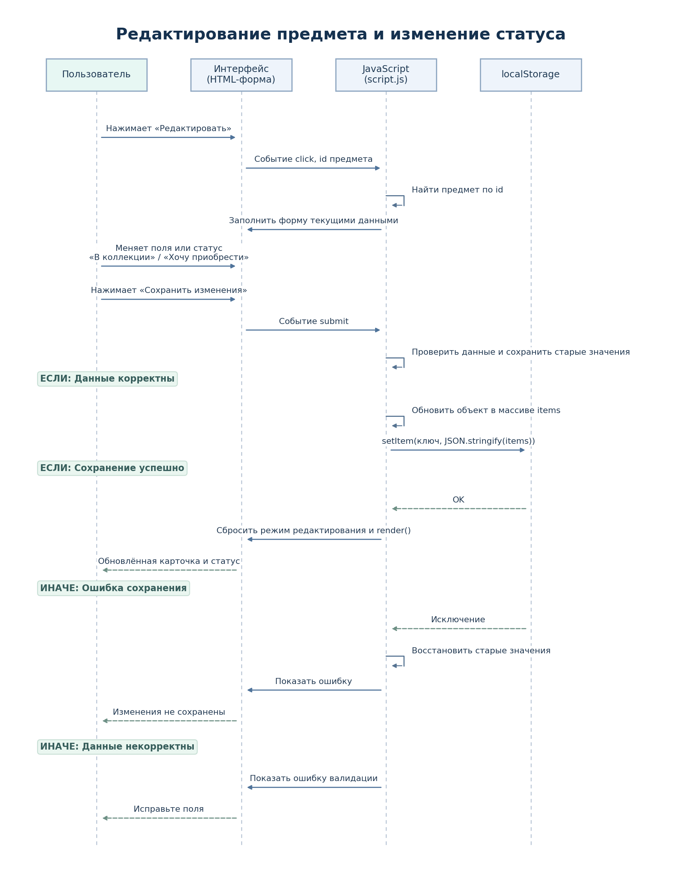
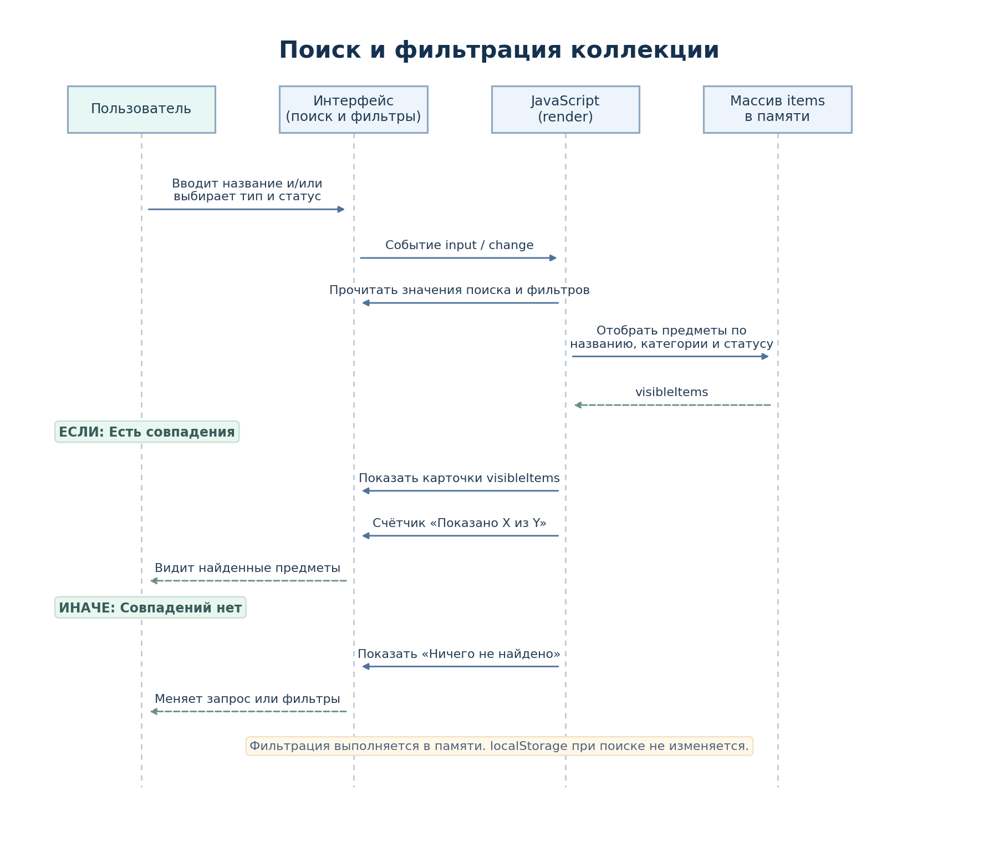
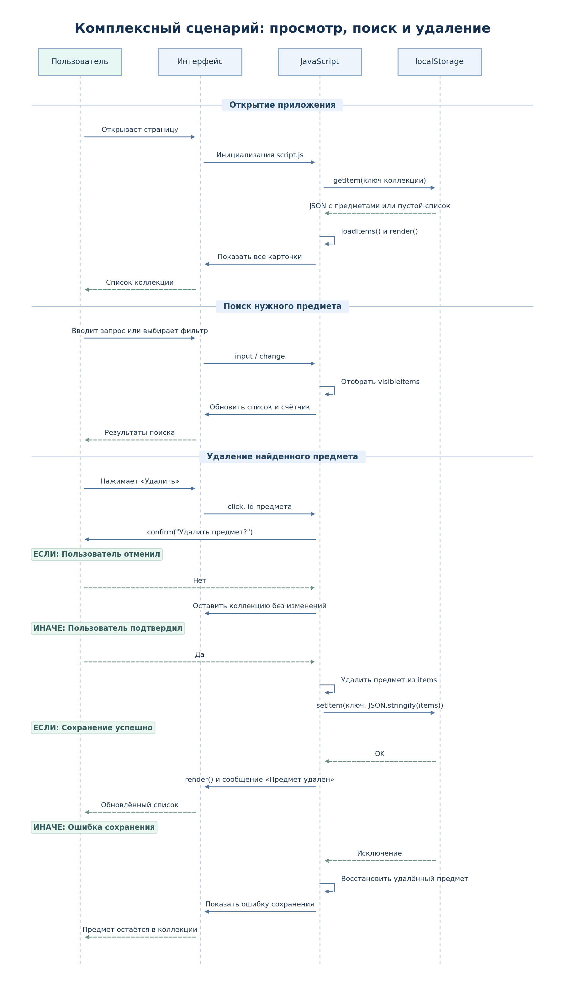

# Диаграммы поведения системы «Органайзер коллекций»

**Автор:** Комлев Александр Алексеевич  
**Репозиторий:** https://github.com/Moonakan/smart-todo-srs  
**Лабораторная работа:** № 5 — моделирование поведения системы.

## Цель

Показать, какие действия доступны пользователю, и описать порядок взаимодействия интерфейса, JavaScript и хранилища браузера при выполнении основных операций.

## Use Case — варианты использования

**Актор:** Пользователь — человек, ведущий личную коллекцию книг, виниловых пластинок, фильмов и игр.

**Основные сценарии:**

- Просмотр списка предметов коллекции.
- Добавление предмета с названием, типом, автором или создателем, годом, заметками и статусом.
- Редактирование данных и изменение статуса «В коллекции» / «Хочу приобрести».
- Удаление предмета после подтверждения.
- Поиск по названию, фильтрация по категории и статусу.

**Отношения:** `include` показывает обязательный шаг сценария, например проверку данных или сохранение изменений. `extend` показывает дополнительное поведение, например поиск во время просмотра списка.

Исходник: [use_case_diagram.puml](../use_case/use_case_diagram.puml).

## Диаграммы последовательности

### 1. Добавление предмета

Пользователь заполняет форму. Скрипт проверяет обязательное название, тип и формат года, добавляет объект в массив и сохраняет коллекцию в `localStorage`. При ошибке сохранения добавление откатывается; при успешном сохранении список обновляется.

### 2. Редактирование предмета и его статуса

Пользователь выбирает предмет, изменяет поля или статус, а скрипт проверяет данные и сохраняет их в `localStorage`. При ошибке сохранения предыдущие значения восстанавливаются.

### 3. Поиск и фильтрация

При вводе запроса или изменении фильтров JavaScript отбирает подходящие предметы из массива в оперативной памяти и обновляет интерфейс. Запись в `localStorage` при фильтрации не выполняется.

### 4. Комплексный сценарий — просмотр, поиск и удаление

При открытии страницы список загружается из `localStorage`. Пользователь находит нужный предмет, нажимает «Удалить» и подтверждает действие. Удаление сохраняется; если сохранить не удалось, предмет возвращается в массив.

## Где находятся исходники

| Сценарий | Файл PlantUML |
| --- | --- |
| Use Case | [`../use_case/use_case_diagram.puml`](../use_case/use_case_diagram.puml) |
| Добавление | [`sequence/add_item_sequence.puml`](sequence/add_item_sequence.puml) |
| Редактирование и статус | [`sequence/edit_status_sequence.puml`](sequence/edit_status_sequence.puml) |
| Поиск и фильтрация | [`sequence/filter_items_sequence.puml`](sequence/filter_items_sequence.puml) |
| Комплексный сценарий | [`sequence/collection_workflow_sequence.puml`](sequence/collection_workflow_sequence.puml) |

## Инструменты и ограничения

- **PlantUML:** текстовое представление UML-диаграмм с хранением исходников в Git.
- **PNG/SVG:** изображения для просмотра в репозитории и на защите.
- **HTML/CSS/JavaScript:** интерфейс приложения.
- **localStorage:** текущее сохранение данных в браузере.

В лабораторной работе № 4 спроектирована реляционная база SQLite, однако текущая браузерная версия приложения не использует SQL-запросы и серверное API. Поэтому диаграммы последовательности показывают существующую архитектуру с `localStorage`, а не вымышленные обращения к серверу.
